


<picture>
  <source media="(prefers-color-scheme: dark)" srcset="assets/h-about-dark.svg" />
  
</picture>

- 🧭 **Technical Lead** at [Design Point Digital](https://designpoint.com.au) — Melbourne web agency
- 🏢 **Tech Lead** on [SAM Network](https://samnet.com.au) — one platform for the entire buildings ecosystem
- 💬 Building **HiToFulbe** — a private family messaging app
- 🎓 Bachelor of Information Technology — **RMIT University** (2025)
- 🌏 From Sri Lanka 🇱🇰 · based in Melbourne 🇦🇺

<picture>
  <source media="(prefers-color-scheme: dark)" srcset="assets/h-building-dark.svg" />
  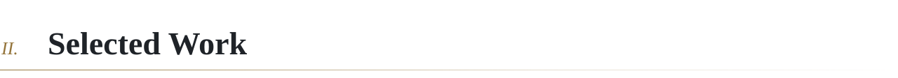
</picture>

<a href="https://samnet.com.au"></a>
<a href="https://designpoint.com.au"></a>
<a href="https://github.com/sef-global"></a>

<picture>
  <source media="(prefers-color-scheme: dark)" srcset="assets/h-journey-dark.svg" />
  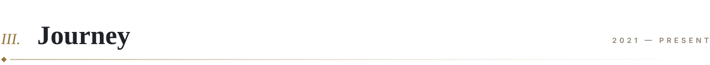
</picture>


<picture>
  <source media="(prefers-color-scheme: dark)" srcset="assets/h-stack-dark.svg" />
  
</picture>

<b>FRONTEND</b> 

<b>BACKEND & CMS</b> 

<b>DATABASES</b> 

<b>CLOUD & DEVOPS</b> 

<b>PLATFORMS & INTEGRATIONS</b> 
        

<b>TOOLS & DESIGN</b> 

<picture>
  <source media="(prefers-color-scheme: dark)" srcset="assets/h-stats-dark.svg" />
  
</picture>

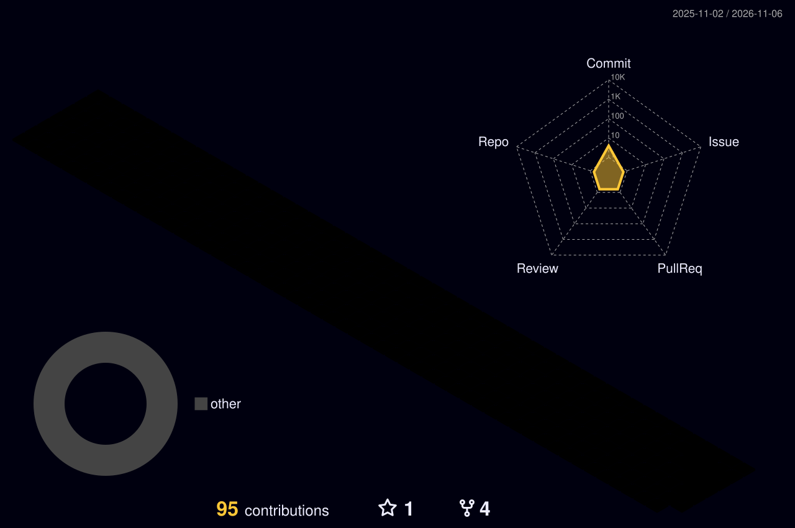

<picture>
  <source media="(prefers-color-scheme: dark)" srcset="https://raw.githubusercontent.com/akeel230/akeel230/output/snake-dark.svg" />
  
</picture>

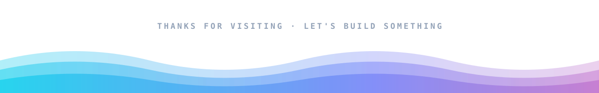
